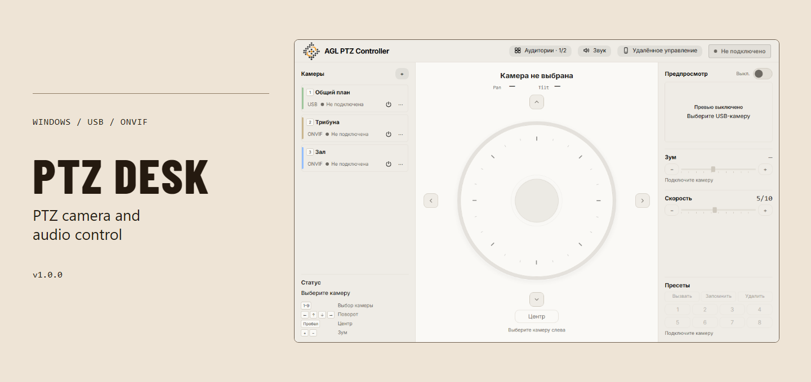
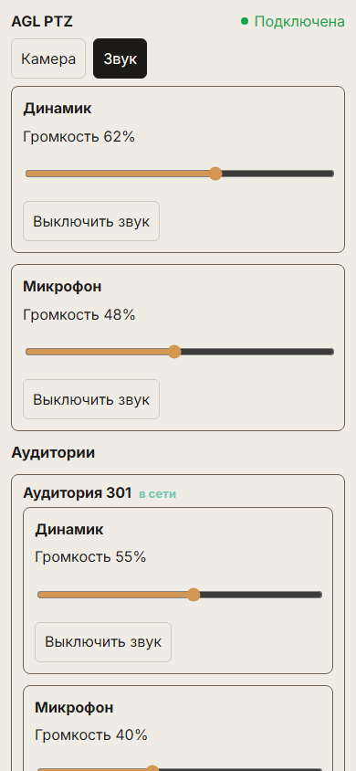

  

<h1 align="center">PTZ Desk</h1>

A Windows operator console for PTZ cameras and audio.

  <a href="https://github.com/StokeleyDev/ptz-desk/releases/latest">Download for Windows</a> ·
  <a href="#quick-start">Quick start</a> ·
  <a href="#screenshots">Screenshots</a>

## Features

- Switch between USB and ONVIF cameras and control pan, tilt, and zoom.
- Pair a phone over a trusted local network to control cameras and adjust speaker and microphone levels.
- Check for stable releases using the update button in the desktop app.

## Quick start

1. Run **PTZ-Desk-Setup-x64.exe**, or extract **PTZ-Desk-Portable-x64.zip** and launch the app from its Portable folder.
2. If prompted, install Microsoft Edge WebView2 Runtime. The portable package includes a helper in Dependencies.
3. Add a camera. To pair your phone, open Remote Control in the app and scan the QR code. The current app interface is shown in Russian.

To uninstall the installed edition, open **Windows Settings → Apps → Installed apps** and select PTZ Desk.

## Screenshots

| Mobile camera controls | Mobile audio controls |
| :---: | :---: |
|  |  |

Screenshots show the application in demo mode.
