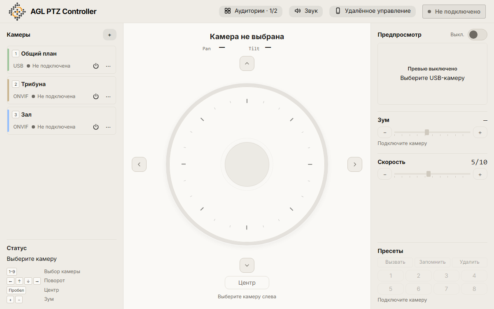
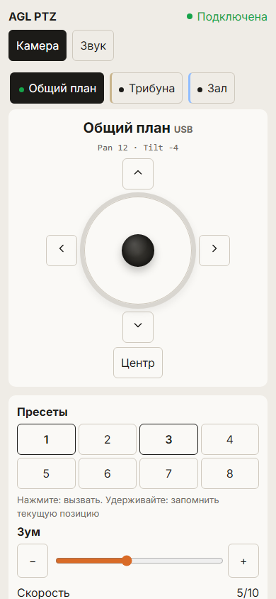

# PTZ Desk

Пульт оператора для Windows. Переключайте USB- и ONVIF-камеры из одного списка, управляйте поворотом, наклоном и зумом. Подключите телефон по локальной сети для управления камерой и звуком.

[Быстрый старт](#быстрый-старт) · [Скриншоты](#скриншоты)

## Скриншоты

| Камера на телефоне | Звук на телефоне |
| :---: | :---: |
|  |  |

Скриншоты сделаны в деморежиме версии 1.5.4.

## Быстрый старт

1. Распакуйте portable-сборку для Windows и запустите приложение из папки Portable.
2. Если появится сообщение о WebView2, запустите установщик из папки Dependencies.
3. Добавьте USB- или ONVIF-камеру. Для управления с телефона откройте «Удалённое управление» и отсканируйте QR-код на доверенной локальной сети.

[Скачать PTZ Desk для Windows](https://github.com/StokeleyDev/ptz-desk/releases/latest)

Для обычной установки запустите PTZ-Desk-Setup-x64.exe. Удаление доступно в «Параметры → Приложения». Portable ZIP содержит приложение и установщик WebView2. Кнопка ↻ проверяет стабильные обновления GitHub Releases.
